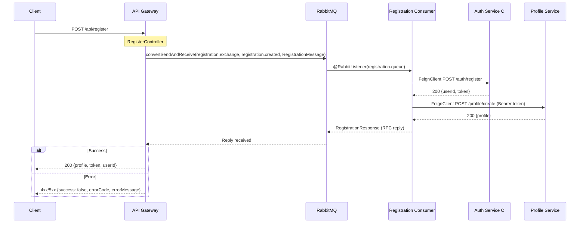

# Registration & RabbitMQ

The API Gateway uses **RabbitMQ** to orchestrate the user registration flow via a saga pattern. This ensures atomicity across the authentication and profile services, with rollback on failure.

## Architecture

### Exchange, Queue, and Routing

| Component | Name | Type |
| --- | --- | --- |
| Exchange | `registration.exchange` | `TopicExchange` |
| Queue | `registration.queue` | Durable queue |
| Routing key | `registration.created` | — |

### Configuration

RabbitMQ is configured via `RabbitMQConfig.java`:

```java
public static final String EXCHANGE = "registration.exchange";
public static final String QUEUE = "registration.queue";
public static final String ROUTING_KEY = "registration.created";
```

Messages are serialized as JSON using `Jackson2JsonMessageConverter`.

Connection settings are read from environment variables:

| Variable | Description |
| --- | --- |
| `RABBITMQ_DEFAULT_USER` | RabbitMQ username |
| `RABBITMQ_DEFAULT_PASS` | RabbitMQ password |
| `spring.rabbitmq.host` | Hostname (`rabbitmq`) |
| `spring.rabbitmq.port` | Port (`5672`) |

## Registration Flow



### Step-by-step

1. **Client** sends `POST /api/register` with `RegistrationRequest` (email, password, username, name, bio, profilePictureUrl).
2. **RegisterController** delegates to `RegistrationService`, which publishes a `RegistrationMessage` to `registration.exchange` with routing key `registration.created` using `RabbitTemplate.convertSendAndReceive()` (RPC-style).
3. **RegistrationConsumer** (`@RabbitListener` on `registration.queue`) receives the message and:
   - Creates the user in **Auth Service C** via `POST /auth/register`.
   - Uses the returned JWT to create the profile in **Profile Service** via `POST /profile/create`.
   - Returns a `RegistrationResponse` with the profile, token, and userId.
4. The **API Gateway** maps the RabbitMQ reply back to the HTTP response.

### RPC (Request-Reply)

The gateway uses Spring AMQP's `convertSendAndReceive()` method, which publishes a message with a temporary reply queue. The `RegistrationConsumer`'s return value is automatically sent back to this reply queue, unblocking the gateway's HTTP request.

## Error Handling & Rollback

The `RegistrationConsumer` implements comprehensive error handling with rollback:

| Exception | HTTP Status | Rollback |
| --- | --- | --- |
| `FeignException.BadRequest` | 400 | No |
| `FeignException.Conflict` | 400 | No |
| `FeignException.Unauthorized` | 401 | No |
| `FeignException.Forbidden` | 403 | No |
| `FeignException.NotFound` | 404 | No |
| `FeignException.ServiceUnavailable` | 503 | Yes — deletes auth user |
| `FeignException.GatewayTimeout` | 504 | Yes — deletes auth user |
| `FeignException.InternalServerError` | 500 | Yes — deletes auth user |
| `FeignException` (generic) | 500 | Yes — deletes auth user |
| `Exception` (unexpected) | 500 | Yes — deletes auth user |

**Rollback** calls `AuthClient.deleteAuthentication(userId)` to remove the auth user if the profile creation fails after the auth user was already created.

## RegistrationMessage

```json
{
  "registrationId": "a1b2c3d4-e5f6-7890-abcd-ef1234567890",
  "request": {
    "email": "user@example.com",
    "password": "Str0ng!Pass",
    "username": "johndoe",
    "name": "John Doe",
    "bio": "Software developer.",
    "profilePictureUrl": "https://example.com/avatar.jpg"
  }
}
```

## RegistrationResponse

Success:

```json
{
  "profile": {
    "userId": "a1b2c3d4-e5f6-7890-abcd-ef1234567890",
    "username": "johndoe",
    "name": "John Doe",
    "biography": "Software developer.",
    "mediaPointer": "https://example.com/avatar.jpg",
    "location": null,
    "link": null,
    "lastEdited": "2026-06-15T10:00:00Z",
    "created_at": "2026-06-15T10:00:00Z"
  },
  "token": "eyJhbGciOiJIUzI1NiIs...",
  "userId": "a1b2c3d4-e5f6-7890-abcd-ef1234567890",
  "success": true
}
```

Error:

```json
{
  "success": false,
  "errorCode": "BAD_REQUEST",
  "errorMessage": "Invalid registration data or user already exists."
}
```
