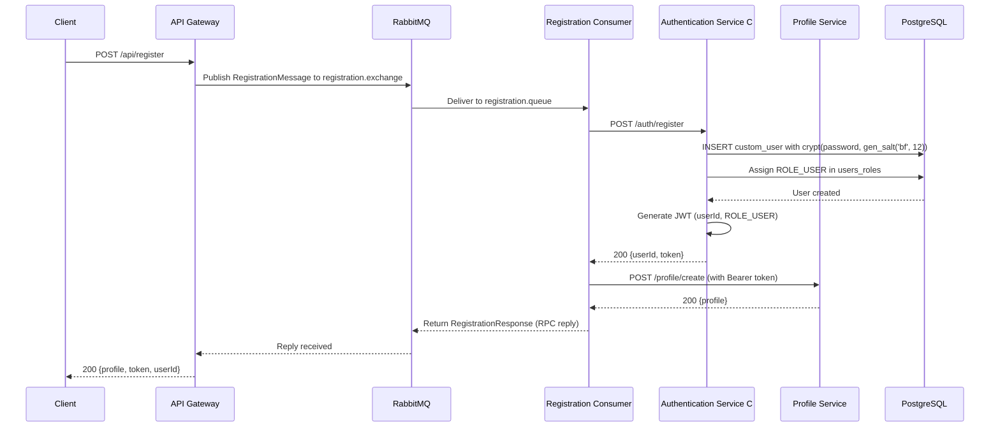
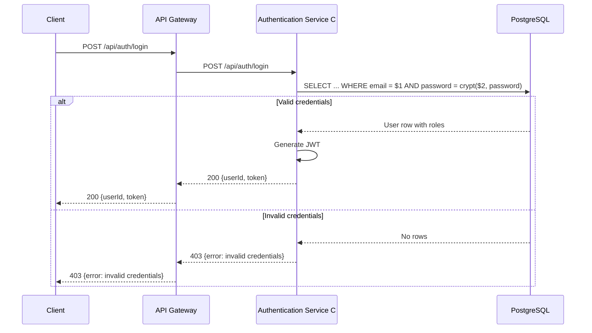

# Authentication Service C Architecture

## Startup Flow

1. `main()` calls `db_init()` which builds a connection string from `SPRING_DATASOURCE_URL` / `DATABASE_URL` environment variables.
2. Connect to PostgreSQL and run idempotent schema migrations.
3. Open a log file (`server.log`) and bind a TCP socket on port `21525`.
4. Initialize a thread-safe connection queue (capacity 64) and spawn 8 worker threads.
5. Start the accept loop; each accepted connection is pushed onto the queue and handled by the next available worker.

## Core Components

- `server.c`
  - HTTP server entry point: socket creation, accept loop, request parsing, routing, response writing.
  - Handles OPTIONS preflight, register, login, delete, admin/staff promotion, dashboard, and `/me` endpoints.
  - Thread pool with 8 worker threads consuming from a bounded producer-consumer queue.
- `crypto_core.c`
  - Pure C SHA-256, HMAC-SHA256, base64 and base64url encoding/decoding.
  - JWT generation and validation (HS256, custom JSON parsing).
  - Email and password format validators.
- `db_core.c`
  - PostgreSQL connection pooling (one thread-local `PGconn` per worker).
  - User CRUD: insert with `crypt()` hashing, authenticate with `crypt()` comparison, delete, role update.
  - Schema migration: creates `pgcrypto` extension, renames legacy tables, creates `custom_user`, `role`, `users_roles`, seeds `ROLE_USER` and `ROLE_ADMIN`.
- `auth_core.h`
  - Public API header declaring all database and JWT functions.
- `request_queue.c`
  - Bounded, thread-safe FIFO queue backed by a fixed-size array with condition variables.
- `worker_pool.c`
  - Thin wrapper that spawns the worker threads.

## General Flow

1. A client sends a request to the API Gateway which either forwards it directly (login, admin, etc.) or routes it through the RabbitMQ saga (registration).
2. For direct calls, the request is parsed by a worker thread: method, path, headers, JSON body.
3. Depending on the route, the worker validates input, calls DB functions, generates or validates JWTs, and sends an HTTP JSON response.
4. Password verification is delegated to PostgreSQL's `crypt()` function (bcrypt).
5. JWT tokens use HMAC-SHA256 with a configurable secret and include `userId`, `role`, `iat`, `exp`, and `iss` claims.

## Sequence Diagrams

### Registration (via RabbitMQ Saga)

The API Gateway orchestrates registration using RabbitMQ as a message broker. The gateway publishes a registration message, a consumer processes it by calling the auth service and then the profile service sequentially.

### Direct Login

### Login

