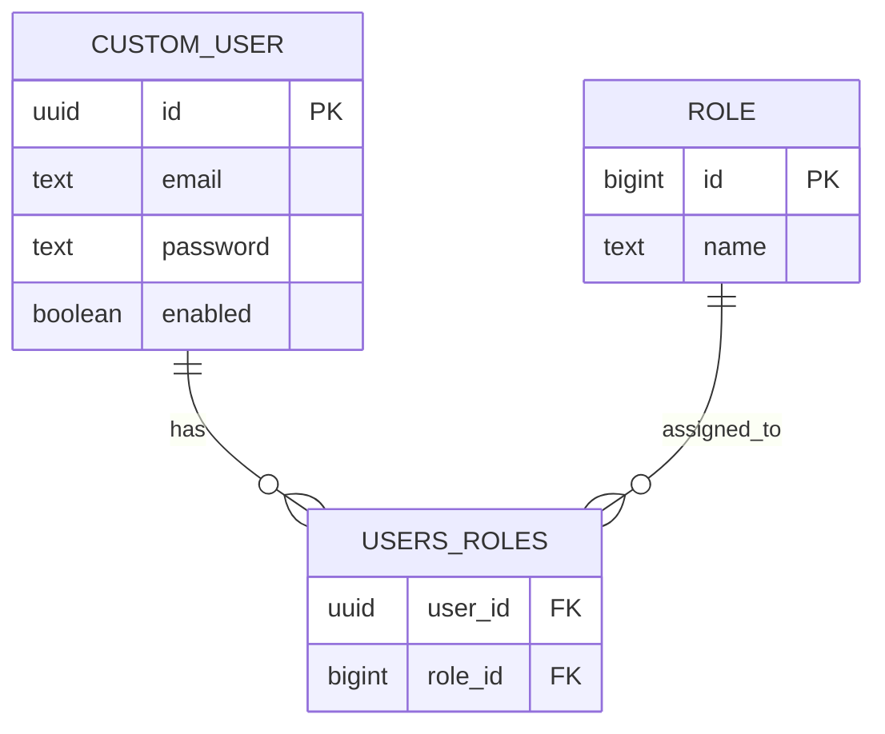

# Database Schema

The service uses the `pgcrypto` extension for bcrypt password hashing.

## Tables

### `custom_user`

Stores user accounts with email-based login.

| Column | Type | Constraints |
| --- | --- | --- |
| `id` | UUID | PRIMARY KEY |
| `email` | TEXT | UNIQUE NOT NULL |
| `password` | TEXT | NOT NULL (bcrypt hash via `crypt()`) |
| `enabled` | BOOLEAN | DEFAULT TRUE |

### `role`

Lookup table for role names.

| Column | Type | Constraints |
| --- | --- | --- |
| `id` | BIGSERIAL | PRIMARY KEY |
| `name` | TEXT | UNIQUE NOT NULL |

### `users_roles`

Many-to-many join table linking users to roles.

| Column | Type | Constraints |
| --- | --- | --- |
| `user_id` | UUID | NOT NULL, FK -> `custom_user(id)` ON DELETE CASCADE |
| `role_id` | BIGINT | NOT NULL, FK -> `role(id)` ON DELETE CASCADE |
| | | PRIMARY KEY (`user_id`, `role_id`) |

## Seed Data

- `ROLE_USER` — default role for new registrations.
- `ROLE_ADMIN` — administrative role with elevated privileges.

## ERD

