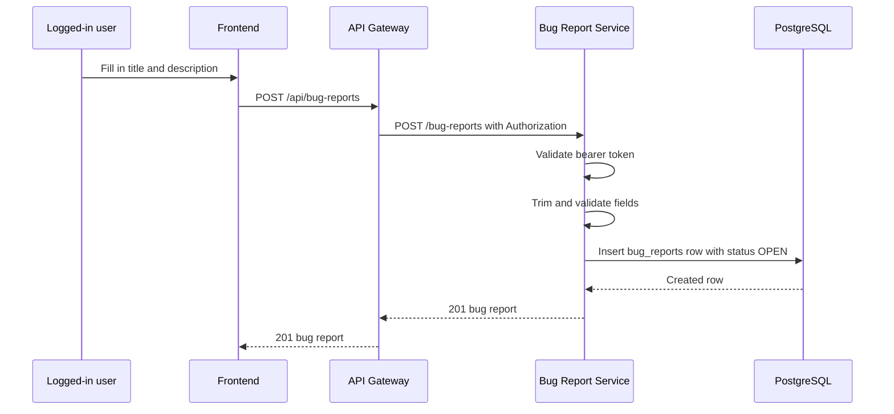
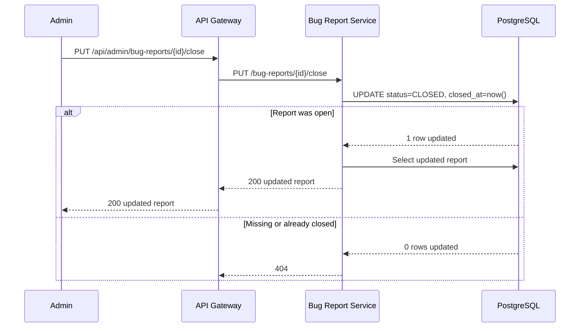

# Bug Report Service Architecture

## Startup Flow

1. Load configuration from environment variables.
2. If `POSTGRES_USER` and `POSTGRES_PASSWORD` are present, connect to the maintenance database and create the service user/database when missing.
3. Connect to the service database.
4. Run idempotent migrations for `bug_reports`.
5. Register HTTP routes and listen on `PORT`, defaulting to `29556`.

## Core Components

- `main.go`
  - loads config, bootstraps PostgreSQL, runs migrations, and serves HTTP.
- `internal/handlers`
  - exposes health, create, list, and close endpoints.
- `internal/db`
  - optionally provisions the service database/user and creates tables/indexes.
- `internal/auth`
  - validates JWTs for report submission.
- `internal/models`
  - defines request and response structures.

## General Flow

1. A logged-in user submits a report through the frontend.
2. The API Gateway forwards `POST /api/bug-reports` to the service as `POST /bug-reports`, preserving the `Authorization` header.
3. The service validates the JWT, trims and validates `title` and `description`, then inserts an `OPEN` report.
4. Administrators use gateway admin routes to list reports and close open reports.
5. Closing a report updates the existing row to `CLOSED` and sets `closed_at`.

## Sequence Diagrams

### Submit Bug Report

### Admin Closes Report

