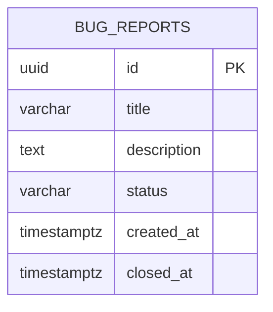

# Database Schema

## Tables

### `bug_reports`

- `id` UUID PRIMARY KEY DEFAULT `gen_random_uuid()`
- `title` VARCHAR(255) NOT NULL
- `description` TEXT NOT NULL
- `status` VARCHAR(20) NOT NULL DEFAULT `OPEN`
- `created_at` TIMESTAMPTZ NOT NULL DEFAULT `NOW()`
- `closed_at` TIMESTAMPTZ NULL

Indexes:

- `idx_bug_reports_status` on `status`
- `idx_bug_reports_created_at` on `created_at DESC`

## ERD

