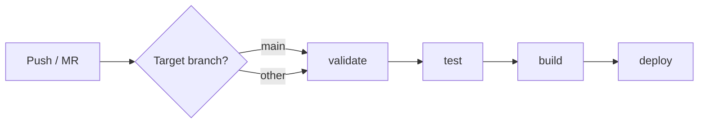

# CI/CD Pipeline

The project uses **GitLab CI/CD** with four stages: **validate → test → build → deploy**.

Pipelines run automatically on every merge request targeting `main` (validate + test) and on every merge to `main` (build + deploy).

## Pipeline Triggers

| Event | Stages | Condition |
|-------|--------|-----------|
| Merge request to `main` | validate, test | Service files changed |
| Merge/push to `main` | build, deploy | `CHANGELOG.md` or `package.json` changed |

## Technology Stack

- **Platform:** GitLab CI/CD
- **Runtime:** Docker-in-Docker (`docker:dind`)
- **Registry:** GitLab Container Registry + Docker Hub
- **Deploy target:** `student.inf.st.hsleiden.nl` (SSH)
- **Artifacts:** JUnit XML, JaCoCo coverage reports (30-day retention)
