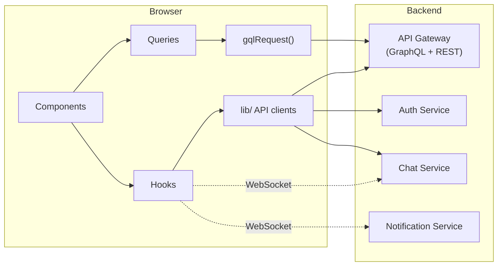
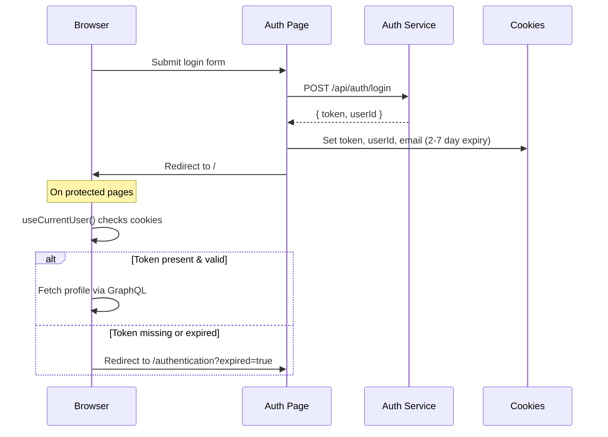

# Architecture

## Project Structure

```
hobby-frontend/
├── app/                   # Next.js App Router
│   ├── (auth)/            # Unauthenticated layout group
│   │   └── authentication/  # Login & register page
│   ├── (main)/            # Authenticated layout group
│   │   ├── page.tsx       # Home feed
│   │   ├── admin/         # Admin panel
│   │   ├── chats/         # Chat list & chat rooms
│   │   ├── discover/      # Search & discovery
│   │   ├── notifications/ # Notification list
│   │   ├── posts/         # Post detail & edit
│   │   ├── profile/       # Own & other profiles
│   │   ├── saved/         # Reading lists
│   │   └── settings/      # Account settings
│   ├── globals.css        # Theme variables & base styles
│   └── layout.tsx         # Root layout
├── components/            # Reusable React components
├── hooks/                 # Custom React hooks
├── lib/                   # API clients & utilities
├── providers/             # React Context providers
├── queries/               # GraphQL query functions
├── types/                 # TypeScript type definitions
├── constants/             # Navigation items, breakpoints
├── public/                # Static assets
```

## Route Groups

The app uses two Next.js route groups to split authenticated from unauthenticated layouts:

- **`(auth)`** — minimal layout for `/authentication`. No navigation bar, no providers that depend on a logged-in user.
- **`(main)`** — wraps every other page. Includes the responsive navigation, notification providers, chat notification providers, and the query client.

## Provider Hierarchy

Providers are nested in the `(main)` layout:

```
QueryProvider               → TanStack React Query
  └─ NotificationProvider   → WebSocket for notifications
    └─ ChatNotificationProvider → WebSocket for chat unread counts
      └─ ProfilePicProvider → Cached profile picture
        └─ ErrorToastProvider → Error toast display
          └─ ResponsiveNavigation + page content
```

## Data Flow



### Request Paths

| Pattern                 | Used for                                       | Client                                   |
| ----------------------- | ---------------------------------------------- | ---------------------------------------- |
| GraphQL via API Gateway | Posts, profiles, followers, reports            | `gqlRequest()` in `lib/graphQlClient.ts` |
| REST via API Gateway    | Post CRUD, interactions, library, admin, media | Various clients in `lib/` using `fetch`  |
| REST direct             | Login, register, password/email changes        | `lib/authenticationClient.ts`            |
| Axios direct            | Chat REST calls                                | `lib/chatClient.ts` via `lib/axios.ts`   |
| WebSocket               | Chat messages, notifications, chat unread      | Custom hooks                             |

### Server vs Client Rendering

GraphQL requests detect the execution context automatically:

- **Server-side** (in Server Components or SSR) — uses `NEXT_PUBLIC_MIDDLEWARE_URL_SERVERSIDE` and reads cookies from `next/headers`.
- **Client-side** — uses `NEXT_PUBLIC_MIDDLEWARE_URL_CLIENTSIDE` and reads cookies from `js-cookie`.

## Authentication Flow



Tokens are JWTs decoded client-side to check expiration and extract the admin role (`ROLE_ADMIN`).

## Styling & Theming

The app uses **Tailwind CSS v4** with custom CSS variables for theming:

| Variable             | Dark mode | Light mode |
| -------------------- | --------- | ---------- |
| `--color-background` | `#050505` | `#f5f5f5`  |
| `--color-brand`      | `#ec4899` | `#ec4899`  |
| `--color-accent`     | `#ffffff` | `#1a1a1a`  |

Custom utility classes:

- `.glass-card` — frosted glass card with backdrop blur
- `.glass-card-hover` — glass card with hover elevation

Theme is toggled via the `useTheme` hook and persisted to `localStorage`.

## Hobby Types

Posts are categorized into three hobby types, each with specific data:

| Type      | Extra fields                        | Description         |
| --------- | ----------------------------------- | ------------------- |
| `GYM`     | Exercises (name, reps, weight, RPE) | Workout logging     |
| `READING` | Page progress, finished status      | Book tracking       |
| `OTHER`   | None                                | Generic hobby posts |

Posts can also link external items (books, movies, exercises) from the Library Service.
