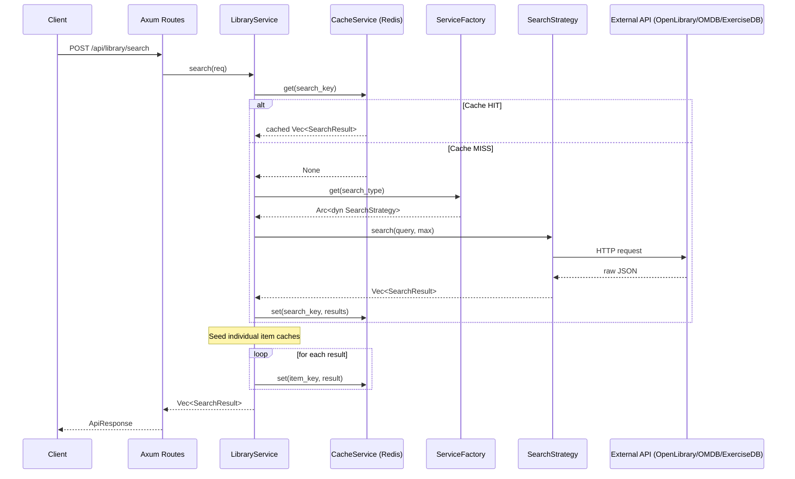

# Architecture

## Design Patterns

The service uses three classical Gang-of-Four patterns to decouple API providers from the core logic:

| Pattern | Role | Location |
| --- | --- | --- |
| **Strategy** | Each external API is a `SearchStrategy` implementation with `search()` and `find_by_id()` methods. | `src/strategy/` |
| **Factory** | `ServiceFactory` registers every strategy in a `HashMap<SearchType, Arc<dyn SearchStrategy>>`. Controllers ask for a strategy by type — no if/else chains. | `src/factory/` |
| **Adapter** | Raw JSON from each API is converted to internal domain models (`Book`, `Movie`, `Exercise`) and then to response DTOs. The rest of the codebase never sees raw JSON. | `src/adapters/` |

## Startup Flow

1. Load environment variables from `.env` (via `dotenvy`).
2. Connect to Redis and PostgreSQL with retry loops.
3. Run sqlx migrations (`001_lists.sql`) creating `lists` and `list_items` tables.
4. Build `ServiceFactory` — registers `OpenLibraryStrategy`, `OmdbStrategy`, `ExerciseDBStrategy`.
5. Construct `AppState` (factory + cache + db).
6. Register Axum routes under `/api/library` with CORS and tracing layers.
7. Listen on `0.0.0.0:28877`.

## Cache-Aside Flow

```mermaid
flowchart TD
    Request --> Cache{Redis cache<br/>hit?}
    Cache -->|HIT| Return[Return cached result]
    Cache -->|MISS| Strategy[SearchStrategy<br/>(external API)]
    Strategy --> Store[Store in Redis<br/>TTL = 30 days]
    Store --> Return
```

**Cache keys:**

| Endpoint | Key format | Example |
| --- | --- | --- |
| Search | `search:{TYPE}:{query}:{max}` | `search:BOOK:clean code:10` |
| Find by ID | `item:{TYPE}:{id}` | `item:MOVIE:tt0111161` |

Redis failures are **non-fatal** — they produce a log warning and the service falls through to the live API transparently. If Redis becomes unhealthy, caching is automatically disabled for 30 seconds then re-enabled.

## Search & Hydration Flow

When searching, the service returns search results and also **seeds individual item caches** so subsequent `find_by_id` calls for results in the list hit Redis directly.



## Core Components

### `src/main.rs`
Bootstraps connections, builds `AppState`, configures CORS/tracing, starts the Axum server.

### `src/lib.rs`
Library crate entry point — re-exports all modules so integration tests can import `library_service::*`.

### `src/routes/mod.rs`
Axum route handlers for search, item lookup, health, and full list CRUD.

### `src/service/mod.rs`
`LibraryService` — orchestrates the cache-aside pattern. The only layer that knows about both cache and strategies.

### `src/cache/mod.rs`
`CacheService` — thin Redis wrapper with key builders, auto-disable on connection errors, and 30-second re-enable timer.

### `src/db.rs`
`DbService` — PostgreSQL CRUD for lists and list items using sqlx.

### `src/factory/mod.rs`
`ServiceFactory` — hashmap-based strategy registry.

### `src/strategy/`
`SearchStrategy` trait + three implementations.

### `src/adapters/`
Raw JSON → domain model → response DTO conversion functions.

### `src/error/mod.rs`
`AppError` enum with proper HTTP status code mapping via Axum's `IntoResponse`.

## Adding a New API

1. Add a variant to `SearchType` in `src/dto/request.rs`
2. Create a domain model in `src/models/`
3. Create an adapter in `src/adapters/`
4. Implement `SearchStrategy` in `src/strategy/`
5. Register in `ServiceFactory::new()` in `src/factory/mod.rs`

No changes needed to the cache layer, service, routes, or response envelope.
