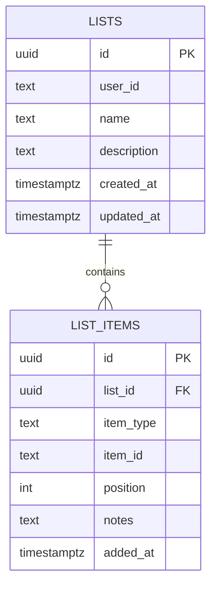

# Database Schema

## Tables

### `lists`

| Column | Type | Constraints | Description |
| --- | --- | --- | --- |
| `id` | `UUID` | `PK DEFAULT gen_random_uuid()` | Unique list identifier |
| `user_id` | `TEXT` | `NOT NULL` | Owner of the list |
| `name` | `TEXT` | `NOT NULL` | Display name |
| `description` | `TEXT` | | Optional description |
| `created_at` | `TIMESTAMPTZ` | `NOT NULL DEFAULT now()` | Creation timestamp |
| `updated_at` | `TIMESTAMPTZ` | `NOT NULL DEFAULT now()` | Last update timestamp |

### `list_items`

| Column | Type | Constraints | Description |
| --- | --- | --- | --- |
| `id` | `UUID` | `PK DEFAULT gen_random_uuid()` | Unique item identifier |
| `list_id` | `UUID` | `NOT NULL REFERENCES lists(id) ON DELETE CASCADE` | Parent list |
| `item_type` | `TEXT` | `NOT NULL` | `BOOK`, `MOVIE`, or `EXERCISE` |
| `item_id` | `TEXT` | `NOT NULL` | External ID (ISBN, IMDb ID, exercise ID) |
| `position` | `INT` | `NOT NULL DEFAULT 0` | Sort order |
| `notes` | `TEXT` | | User notes |
| `added_at` | `TIMESTAMPTZ` | `NOT NULL DEFAULT now()` | Added timestamp |
| | | `UNIQUE (list_id, item_id, item_type)` | Prevents duplicates |

## Indexes

| Index | Table | Column(s) |
| --- | --- | --- |
| `idx_lists_user_id` | `lists` | `user_id` |
| `idx_list_items_list` | `list_items` | `list_id` |

## ERD

## Notes

- `list_items` uses `ON DELETE CASCADE` — deleting a list removes all its items.
- The `UNIQUE (list_id, item_id, item_type)` constraint prevents adding the same item to a list twice.
- `position` is managed via the reorder endpoint; new items are appended at the end.
