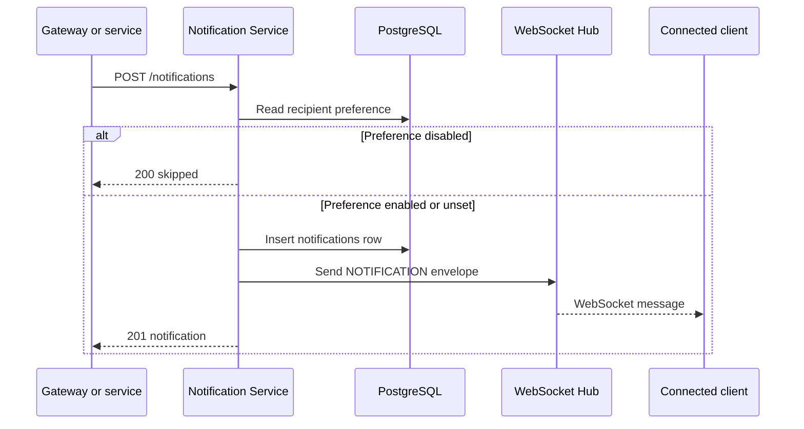
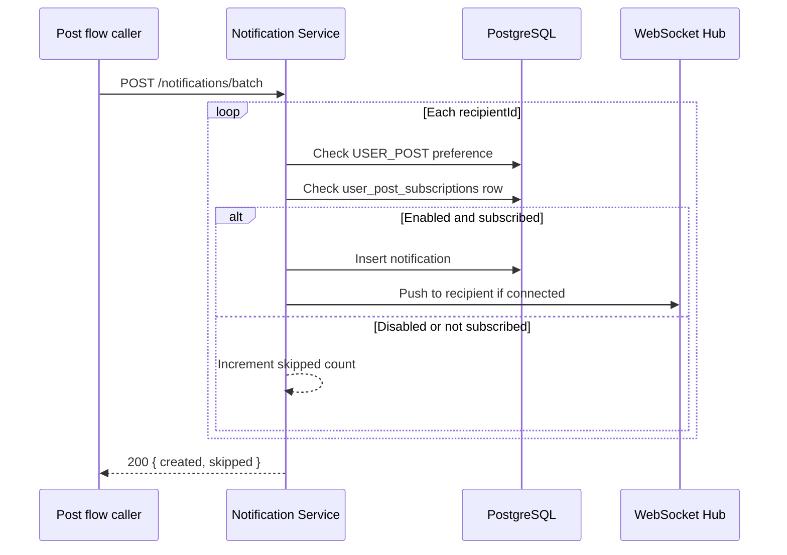
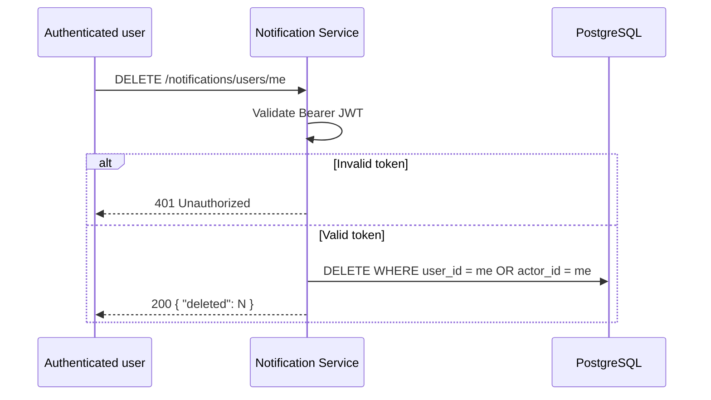
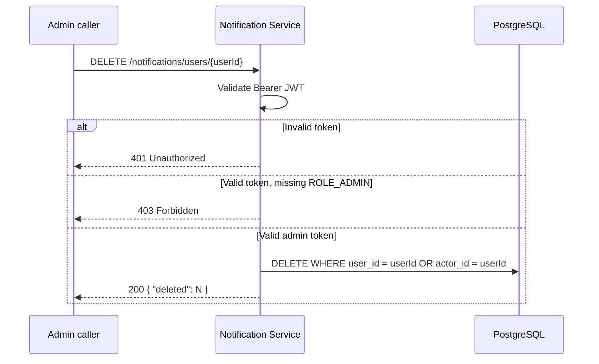
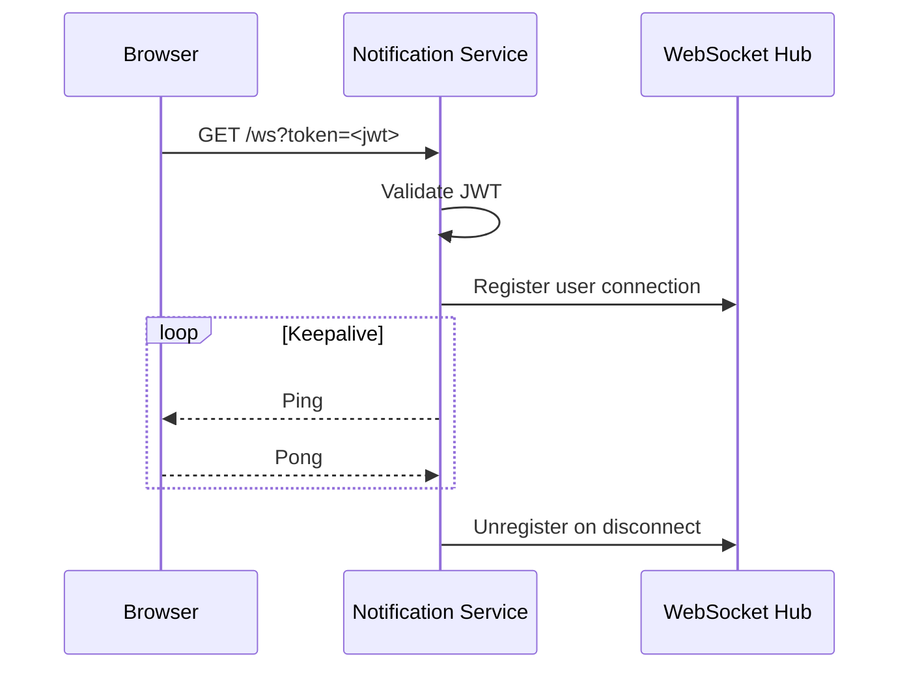

# Notification Service Architecture

## Startup Flow

1. Load configuration from environment variables.
2. Connect to PostgreSQL.
3. Run idempotent migrations for notification tables, preferences, and post subscriptions.
4. Create the in-memory WebSocket hub.
5. Register HTTP routes and start listening on `PORT`, defaulting to `29555`.

## Core Components

- `main.go`
  - loads config, connects to the database, runs migrations, starts the WebSocket hub, and serves HTTP.
- `internal/handlers`
  - exposes health, notification CRUD, preferences, post subscriptions, and WebSocket upgrade endpoints.
- `internal/hub`
  - tracks active WebSocket clients by user and forwards live notification payloads.
- `internal/db`
  - connects to PostgreSQL and creates required tables/indexes.
- `internal/auth`
  - validates JWTs used by user-facing HTTP endpoints and WebSocket connections.
- `internal/metrics`
  - registers Prometheus counters and histograms, wraps every handler to record request count and duration, and exposes a `/metrics` endpoint.

## General Flow

1. Clients open `GET /ws?token=<jwt>` to register a WebSocket connection for the authenticated user.
2. Internal callers create notifications through `POST /notifications` or `POST /notifications/batch`.
3. Before persisting, the service checks the recipient's notification preference for that type.
4. For batch `USER_POST` notifications, the service also checks whether each recipient is subscribed to the actor/author.
5. Accepted notifications are inserted into PostgreSQL and pushed to any active WebSocket connection for the recipient.
6. Authenticated users can list notifications, mark one or all as read, and fetch unread counts.

## Sequence Diagrams

### Single Notification Creation

### User Post Batch Notification

### Self-Service Notification Deletion

### Admin Notification Deletion

### WebSocket Registration

