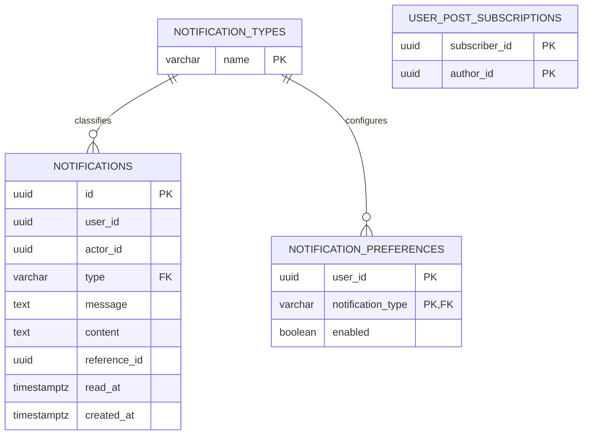

# Database Schema

## Tables

### `notification_types`

- `name` VARCHAR(50) PRIMARY KEY
- Seeded values: `FOLLOW`, `USER_POST`, `RECOMMENDED_POST`, `LIKE`, `COMMENT`

### `notifications`

- `id` UUID PRIMARY KEY DEFAULT `gen_random_uuid()`
- `user_id` UUID NOT NULL
- `actor_id` UUID NULL
- `type` VARCHAR(50) NOT NULL REFERENCES `notification_types(name)`
- `message` TEXT NOT NULL
- `content` TEXT NULL
- `reference_id` UUID NULL
- `read_at` TIMESTAMPTZ NULL
- `created_at` TIMESTAMPTZ NOT NULL DEFAULT `NOW()`

Indexes:

- `idx_notifications_user_id` on `user_id`
- `idx_notifications_created_at` on `created_at DESC`

### `notification_preferences`

- `user_id` UUID NOT NULL
- `notification_type` VARCHAR(50) NOT NULL REFERENCES `notification_types(name)`
- `enabled` BOOLEAN NOT NULL DEFAULT `TRUE`
- PRIMARY KEY (`user_id`, `notification_type`)

### `user_post_subscriptions`

- `subscriber_id` UUID NOT NULL
- `author_id` UUID NOT NULL
- PRIMARY KEY (`subscriber_id`, `author_id`)

Indexes:

- `idx_user_post_subscriptions_author` on `author_id`

## ERD

