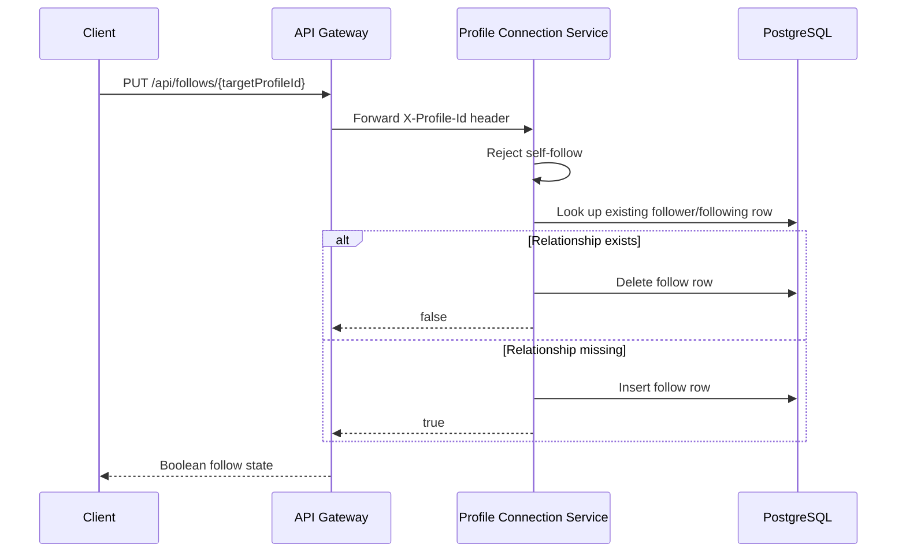
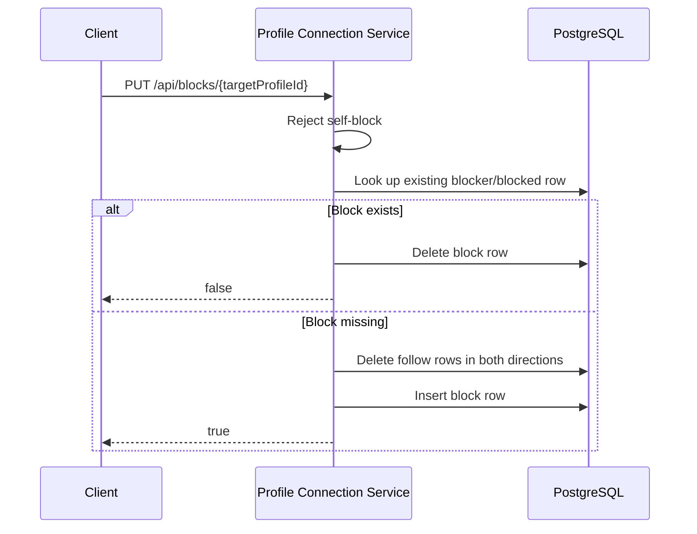
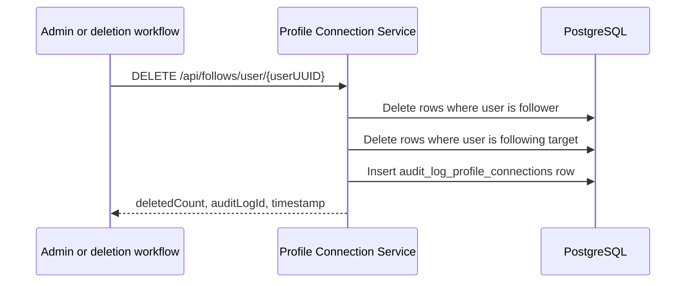

# Profile Connection Service Architecture

## Startup Flow

1. Spring Boot loads configuration from `application.properties` and environment variables.
2. The app connects to PostgreSQL through `SPRING_DATASOURCE_URL`.
3. Hibernate updates the schema with `spring.jpa.hibernate.ddl-auto=update`.
4. `DatabaseSeeder` inserts mock profiles, follows, blocks, and reports when the `profiles` table is empty.
5. Spring Security disables CSRF, permits requests, and applies CORS rules from `CORS_ALLOWED_ORIGINS`.
6. Controllers are exposed under the `/api` servlet context path.

## Core Components

- `FollowController` / `FollowService`
  - toggles follow relationships and returns followers/following lists.
- `BlockController` / `BlockService`
  - toggles block relationships, removes follows between blocked users, and returns blocked profile IDs.
- `ReportController` / `ReportService`
  - creates profile reports, fetches by target/initiator/status, updates status, and deletes report data.
- `AuditLogService`
  - writes audit log records for right-to-be-forgotten deletion operations.
- `DatabaseSeeder`
  - seeds local/demo profile graph data only when no profiles exist.
- Spring Boot Actuator
  - exposes `/actuator/health` and `/actuator/prometheus` endpoints for liveness checks and Prometheus metrics scraping.

## Relationship Rules

- A profile cannot follow itself.
- A profile cannot block itself.
- Creating a block removes follow records in both directions between the blocker and blocked profile.
- Profile reports cannot target the same profile as the initiator.
- Follow, block, and report deletion endpoints remove records where the user is either initiator or target.

## Sequence Diagrams

### Toggle Follow

### Toggle Block

### Delete User Relationship Data

