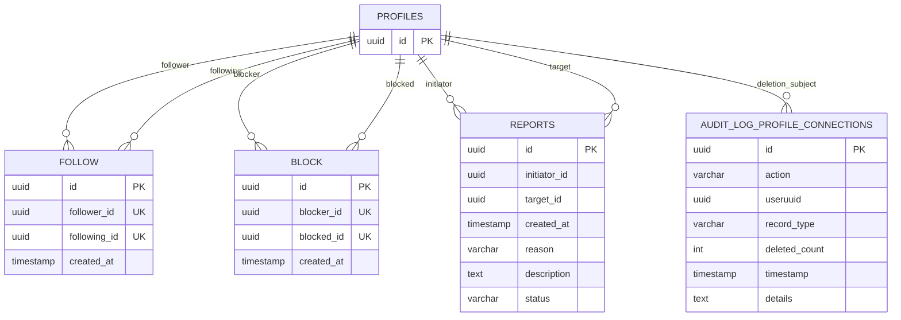

# Database Schema

Hibernate manages the schema with `spring.jpa.hibernate.ddl-auto=update`.

## Tables

### `profiles`

- `id` UUID PRIMARY KEY

The table is used by the local/demo seeder to decide whether seed data already exists.

### `follow`

- `id` UUID PRIMARY KEY
- `follower_id` UUID
- `following_id` UUID
- `created_at` timestamp
- UNIQUE (`follower_id`, `following_id`)

### `block`

- `id` UUID PRIMARY KEY
- `blocker_id` UUID
- `blocked_id` UUID
- `created_at` timestamp
- UNIQUE (`blocker_id`, `blocked_id`)

### `reports`

- `id` UUID PRIMARY KEY
- `initiator_id` UUID
- `target_id` UUID
- `created_at` timestamp
- `reason` varchar NOT NULL
- `description` TEXT NULL
- `status` varchar NOT NULL

### `audit_log_profile_connections`

- `id` UUID PRIMARY KEY
- `action` varchar NOT NULL
- `useruuid` UUID NOT NULL
- `record_type` varchar NOT NULL
- `deleted_count` integer NOT NULL
- `timestamp` timestamp NOT NULL
- `details` TEXT NULL

## ERD

## Seeder

`DatabaseSeeder` inserts demo data only when the `profiles` table is empty. It creates mock profiles, follow relationships, block relationships, and reports for local development/testing.
