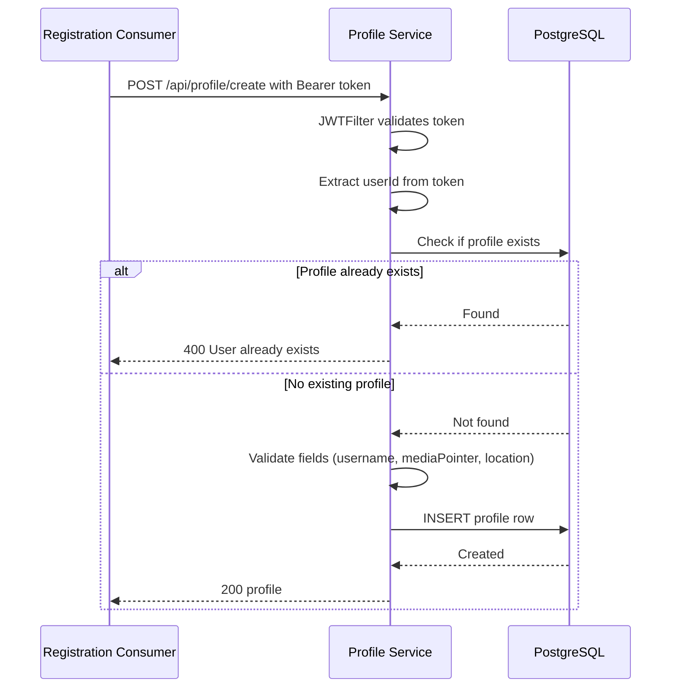
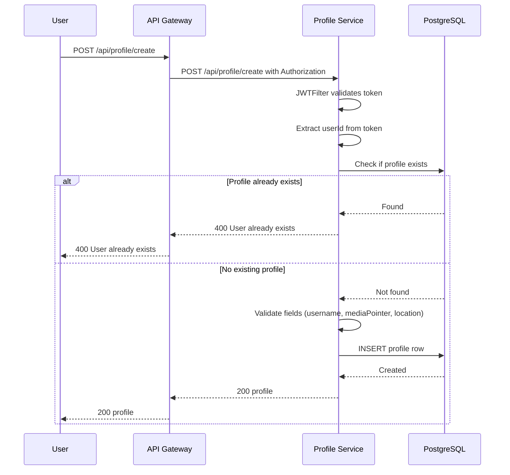

# Profile Service Architecture

## Startup Flow

1. Spring Boot loads configuration from environment variables via `spring-dotenv`.
2. JPA/Hibernate synchronises the schema (`ddl-auto=update`) based on the `Profile` entity.
3. Spring Security is configured with a JWT filter, stateless sessions, and CORS settings.
4. The embedded Tomcat server starts on port `21526` with context path `/api`.
5. HTTP routes are registered by `ProfileController`.

## Core Components

- `ProfileController`
  - REST controller mapped to `/profile` with CRUD endpoints for user profiles.
- `ProfileDAO`
  - Business logic layer that validates and orchestrates profile creation and updates.
- `ProfileRepository`
  - Spring Data JPA repository for `Profile` entities.
- `Profile` (entity)
  - JPA entity mapped to the `profile` table with fields for user ID, username, name, biography, media pointer, link, location, and timestamps.
- `SecurityConfig`
  - Spring Security filter chain: JWT filter before `UsernamePasswordAuthenticationFilter`, public GET access to `/profile/**`, authenticated for all other methods.
- `JWTFilter`
  - `OncePerRequestFilter` that extracts a Bearer token, validates it via `JWTUtil`, and sets the `SecurityContext`.
- `JWTUtil`
  - Auth0 `java-jwt` library wrapper that verifies HMAC-256 JWTs with the configured secret and issuer.
- `CredentialValidator`
  - Validation utilities for media pointer, location, and username formatting.

## General Flow

1. A client sends a request to the API Gateway which forwards it to the profile service.
2. For write operations (create, update, delete), the JWT filter extracts and validates the bearer token, setting the user ID as the authentication principal.
3. The controller delegates to `ProfileDAO` which validates fields and persists changes.
4. Read operations (`GET /profile/**`) are publicly accessible and return profile data without authentication.
5. The `lastEdited` timestamp is automatically updated on every modification.
6. Profile creation during registration is triggered by the API Gateway's `RegistrationConsumer` via RabbitMQ, which calls `POST /profile/create` with the JWT obtained from the auth service.

## Sequence Diagrams

### Create Profile (via Registration Saga)

During registration, the profile is created by the RabbitMQ consumer after the auth user is created:

### Direct Profile Operations

