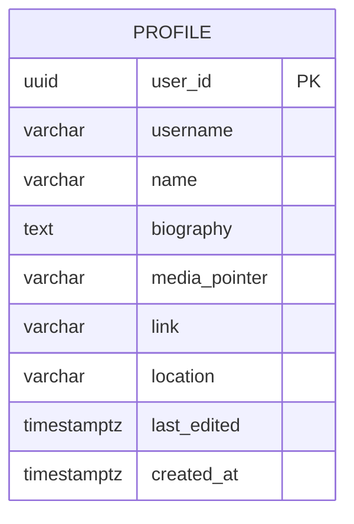

# Database Schema

The schema is managed by JPA/Hibernate with `ddl-auto=update`, creating the `profile` table automatically from the `Profile` entity.

## Table

### `profile`

| Column | Type | Constraints |
| --- | --- | --- |
| `user_id` | UUID | PRIMARY KEY |
| `username` | VARCHAR(255) | UNIQUE |
| `name` | VARCHAR(255) | |
| `biography` | TEXT | |
| `media_pointer` | VARCHAR(255) | Profile picture URL |
| `link` | VARCHAR(255) | External link (e.g. personal website) |
| `location` | VARCHAR(255) | Free-text location |
| `last_edited` | TIMESTAMPTZ | Updated on every profile modification |
| `created_at` | TIMESTAMPTZ | DEFAULT `NOW()`, set once on creation |

## ERD

